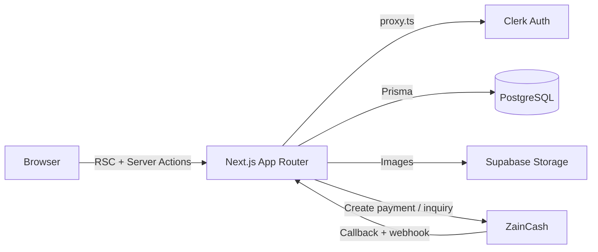

<div align="center">

# 🛋️ Furniture Store

### Modern furniture e-commerce with ZainCash wallet payments

         

**[🌐 Live Demo](https://furniture-store-two-psi.vercel.app)** · **[📦 Source](https://github.com/n1j10/furniture-store)**

</div>

---

## ✨ Overview

A furniture shop with a full shopping experience and **ZainCash** mobile-wallet checkout (Payment Gateway v2, OAuth2). It includes an admin dashboard with a sales overview.

The app uses the **Next.js App Router** with **React Server Components** and **Server Actions**, so the storefront needs no separate REST layer. Prisma provides end-to-end typed data access, and Zod validates every mutation before it reaches the database.

## 🧩 Features

**Customer**
- 🛍️ Product catalog with search, category filters and a featured carousel
- 🛒 Server-side cart; totals are **always recomputed on the server**
- ❤️ Favorites, ⭐ reviews and ratings
- 💳 Online checkout with **ZainCash** and a payment result page
- 📦 Order history with payment status
- 🌗 Dark and light themes, fully responsive UI

**Admin dashboard** (`/admin`)
- Products CRUD with image upload (Supabase Storage)
- Sales dashboard
- Orders overview

## 🏗️ Architecture



**Payment flow (the server decides):**
1. The server computes the order total from the cart in the database. The client never supplies it.
2. ZainCash returns a hosted payment page where the user pays.
3. On callback or webhook, the server makes a **server-to-server status inquiry** and settles the order in a **Serializable transaction**. Settlement is idempotent, so an order can never be marked paid twice.

## 🔐 Security

Security was designed in from the start:

| Area | Implementation |
| --- | --- |
| Authentication | `/admin` is guarded in `proxy.ts`, and every admin Server Action checks again (defense in depth) |
| Authorization | All admin mutations call `getAdminUser()`. Cart, favorites and orders are always scoped to the session user (no IDOR) |
| Input validation | Zod schemas for products, reviews, images and cart quantities (integer, 1–100), which blocks negative-price manipulation |
| Payments | OAuth2 client credentials with token caching. Callback and webhook tokens are verified as **HS256 JWTs**, and the inquiry API confirms the final status. Webhook events are idempotent and HTTPS is enforced |
| File uploads | Images only, 1 MB cap, sanitized storage keys. Old images are looked up in the database, never taken from client input |
| Spoofing | Review author name and avatar come from the session, not the form |
| HTTP headers | HSTS, `X-Frame-Options`, `nosniff`, `Referrer-Policy`, `Permissions-Policy`; `X-Powered-By` removed |

> Secrets are stored only in environment variables. `.env*` is git-ignored, and `.env.example` contains placeholders only.

## 🛠️ Tech Stack

| Layer | Tech |
| --- | --- |
| Framework | Next.js 16 (App Router, RSC, Server Actions) · React 19 |
| Language | TypeScript (strict) |
| Database | PostgreSQL · Prisma ORM |
| Auth | Clerk |
| Payments | ZainCash |
| Storage | Supabase Storage |
| UI | Tailwind CSS v4 · shadcn/ui · Embla Carousel · next-themes |
| Validation | Zod |

## 📁 Project Structure

```
app/
├── (root)/            # storefront: products, cart, orders, favorites, reviews
│   └── api/payment/   # checkout, callback & webhook route handlers
├── (dashboard)/admin/ # admin dashboard
components/            # UI grouped by feature
lib/                   # payment gateway client
utils/
├── actions/           # Server Actions (cart, orders, products, …)
├── schema.ts          # Zod schemas
└── db.ts              # Prisma client singleton
prisma/schema.prisma   # data model
proxy.ts               # route protection (Clerk)
```

## 🚀 Getting Started

```bash
# 1. Install
npm install

# 2. Configure environment
cp .env.example .env        # fill in the values

# 3. Database
npx prisma migrate deploy   # or: npx prisma db push

# 4. Run
npm run dev                 # http://localhost:3000
```

## ☁️ Deployment

Deployed on **Vercel**. Add the variables from `.env.example` under *Project → Settings → Environment Variables*, then push. Vercel builds and deploys automatically.

`WEBSITE_URL` must be the HTTPS production URL because ZainCash redirects back to it.

## 👤 Author

**n1j10**, full-stack engineer (Next.js · TypeScript · Node.js · PostgreSQL)

[](https://github.com/n1j10)

> If you find this project useful, a ⭐ on the repo is appreciated.
